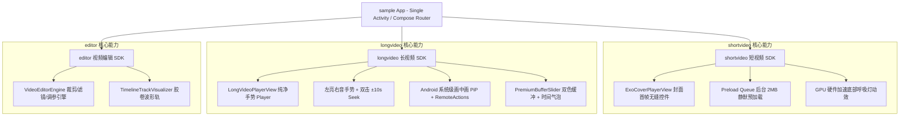
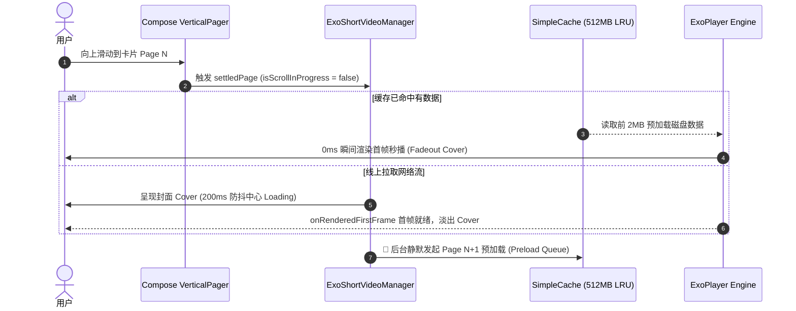

# VideoKit 🎬

[](https://developer.android.com/studio/releases/gradle-plugin)
[](https://gradle.org)
[](https://kotlinlang.org)
[](https://developer.android.com/guide/topics/media/media3)
[](https://developer.android.com/jetpack/compose)

**VideoKit** 是一个基于 **Android Jetpack Compose** 与 **AndroidX Media3 (ExoPlayer)** 构建的工业级 Android 音视频 SDK 解决方案全家桶。涵盖**抖音级短视频无缝滑动播放**、**YouTube 级沉浸式长视频播放（含画中画 PiP）**以及**交互式视频裁剪与调参引擎**。

---

## 📐 架构与设计图示 (Architecture Diagrams)

### 1. 系统模块架构图 (System Architecture)



### 2. 短视频滑动预加载与状态流转图 (Short Video Flow)



---

## 🌟 核心功能矩阵 (Feature Matrix)

| 业务板块 | 核心特性 | 技术亮点 |
| :--- | :--- | :--- |
| **短视频 (`shortvideo`)** | 抖音级 0 延迟滑动播放 | 200ms 防抖起播、GPU 硬件加速底部发光呼吸灯、`settledPage` 沉降起播、512MB LRU 后台 **Preload Queue 预加载** |
| **长视频 (`longvideo`)** | YouTube 级沉浸式全能播放器 | **系统级画中画 (PiP Mode)** 带【▶/❚❚】RemoteActions 控件、左亮右音手势、双击 ±10s 微调、0.5x~2.0x 倍速、**按压加粗 2.5dp $\rightarrow$ 6dp 双色缓冲进度条与 [01:45] 随动时间气泡** |
| **视频编辑 (`editor`)** | 交互式裁剪与调参引擎 | **Compose Canvas 胶卷波形轨** (`TimelineTrackVisualizer`)、多款滤镜切换、亮度/对比度/饱和度实时仪表板与导出参数封装 (`VideoEditParams`) |
| **全局稳定防护** | 崩溃与网络容错防护 | 解决 `ExoTimeoutException` 生命安全拦截、`configChanges` 防旋转销毁、**全局断网警示与联网无缝自动恢复 (`Network Recovery`)** |

---

## 🚀 快速开始与使用指南 (Usage Guide)

### 1. 接入短视频滑动播放器 (`ExoCoverPlayerView`)

```kotlin
@Composable
fun ShortVideoPage(videoUrl: String, exoManager: ExoShortVideoManager) {
    AndroidView(
        factory = { context ->
            ExoCoverPlayerView(context).also { coverView ->
                // 在滑动沉降后触发播放
                exoManager.playVideoFromCoverView(coverView, videoUrl)
                // 静默预加载下一个视频
                exoManager.preloadNextVideo(nextVideoUrl)
            }
        },
        modifier = Modifier.fillMaxSize()
    )
}
```

### 2. 接入长视频播放器与手势交互 (`LongVideoPlayerView`)

```kotlin
@Composable
fun LongVideoPage(videoUrl: String, lifecycleOwner: LifecycleOwner) {
    AndroidView(
        factory = { context ->
            LongVideoPlayerView(context).apply {
                bindLifecycle(lifecycleOwner)
                playUrl(videoUrl)
                setSpeed(1.25f) // 1.25 倍速
            }
        },
        modifier = Modifier.fillMaxSize()
    )
}
```

### 3. 接入精细化双色缓冲进度条 (`PremiumBufferSlider`)

```kotlin
PremiumBufferSlider(
    currentPositionMs = currentPositionMs,
    bufferedPositionMs = bufferedPositionMs,
    durationMs = durationMs,
    onSeekTo = { targetMs -> playerViewInstance?.seekTo(targetMs) },
    onDraggingStateChanged = { dragging -> isDragging = dragging }
)
```

---

## 🛠️ 编译与构建说明 (Build & Verify)

```bash
# 全量 Android Debug 构建
./gradlew assembleDebug

# 极净清理与全量构建
./gradlew clean assembleDebug
```

---

## 📄 License
VideoKit is licensed under the Apache 2.0 License.
