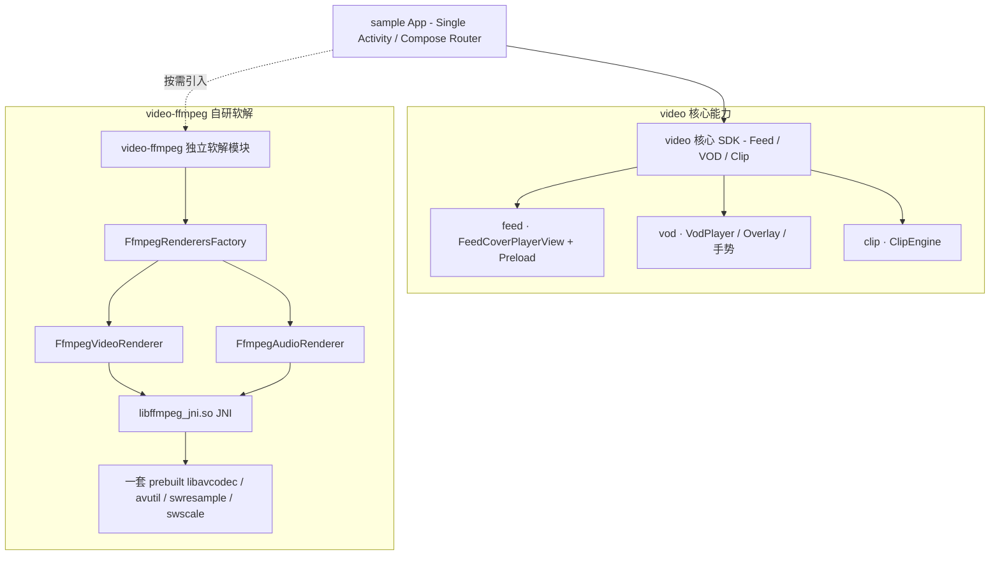

# VideoKit 🎬

[](https://developer.android.com/studio/releases/gradle-plugin)
[](https://gradle.org)
[](https://kotlinlang.org)
[](https://developer.android.com/guide/topics/media/media3)
[](https://developer.android.com/jetpack/compose)

**VideoKit** 是一个基于 **Android Jetpack Compose** 与 **AndroidX Media3 (ExoPlayer)** 构建的工业级 Android 音视频 SDK。涵盖 **竖滑 Feed**、**沉浸点播 VOD（含 PiP）**、**剪辑调参 Clip**，以及按需加载的 FFmpeg NDK 软解扩展（`:video-ffmpeg`）。

---

## 📐 架构与设计图示 (Architecture Diagrams)

### 1. 独立模块系统架构图 (System Architecture)



### 2. Media3 / FFmpeg / JNI 职责划分

本项目采用 **分轨软解**，不是“整文件交给 FFmpeg 一体播放”。

```text
URL / 文件
    │
    ▼
┌──────────────────────────────────────────────────────────┐
│ Media3 ExoPlayer（播放引擎）                                │
│  · 解复用（Extractor / MediaSource）                        │
│  · 轨选择、缓冲、seek、倍速、A/V 同步时钟                      │
│  · 生命周期、错误回调                                        │
│  · 默认解码：MediaCodecVideoRenderer / MediaCodecAudioRenderer│
└───────────────┬──────────────────────────┬───────────────┘
                │ 视频轨（可选替换）            │ 音频轨（可选替换）
                ▼                            ▼
┌──────────────────────────┐   ┌──────────────────────────┐
│ FfmpegVideoRenderer      │   │ FfmpegAudioRenderer      │
│ （Kotlin，Media3 扩展点）  │   │ （Kotlin，Media3 扩展点）  │
│ DecoderVideoRenderer 契约 │   │ DecoderAudioRenderer 契约 │
└────────────┬─────────────┘   └────────────┬─────────────┘
             │                              │
             ▼                              ▼
┌──────────────────────────────────────────────────────────┐
│ JNI：libffmpeg_jni.so                                 │
│  · 把 Java/Kotlin ByteBuffer、Surface 转成 C 可操作内存     │
│  · 调用 FFmpeg C API（avcodec_send/receive、sws、swr…）     │
│  · 视频：YUV → VideoDecoderOutputBuffer / Surface           │
│  · 音频：PCM → SimpleDecoderOutputBuffer → AudioSink        │
└────────────┬─────────────────────────────────────────────┘
             ▼
┌──────────────────────────────────────────────────────────┐
│ FFmpeg 运行时（一套 so，build_ffmpeg.sh 编译）               │
│  libavcodec / libavutil / libswscale / libswresample …     │
│  · 真正的压缩码流解码算法                                    │
└──────────────────────────────────────────────────────────┘
```

| 层级 | 职责 | 不负责 |
|------|------|--------|
| **Media3** | 解复用、同步、缓冲、选轨、把 sample 送给 Renderer、PCM 上 AudioTrack、Surface 时序 | 具体压缩算法实现 |
| **Renderer（Kotlin）** | 实现 Media3 扩展接口；声明支持的 mime；管理 Decoder 生命周期 | 直接操作 FFmpeg C 结构体 |
| **JNI（`.so`）** | Java ↔ C 桥接；线程/缓冲安全；调用 FFmpeg；像素/PCM 回填 | 播放列表、UI、A/V 同步策略 |
| **FFmpeg（`libav*`）** | H.264/HEVC/AV1/AAC… 解码与格式转换 | Android 播放器框架 |

一句话：**Media3 管“怎么播”，FFmpeg 管“怎么解”，JNI 是两者之间的桥。**

---

## 🌟 核心功能矩阵 (Feature Matrix)

| 业务板块 | 核心特性 | 技术亮点 |
| :--- | :--- | :--- |
| **竖滑 Feed (`feed`)** | 信息流滑动秒播 | Cover / 200ms 防抖起播、底部呼吸灯、`settledPage` 沉降起播、Preload Queue |
| **沉浸点播 VOD (`vod`)** | 单路沉浸播放 | PiP、手势亮/音、倍速、`VodPlayer` Overlay、双色进度条 |
| **剪辑 Clip (`clip`)** | 裁剪与调参 | `ClipEngine` / `ClipParams` |
| **FFmpeg (`video-ffmpeg`)** | 自研音视频软解 | **同一套 so** + `FfmpegVideoRenderer` / `FfmpegAudioRenderer`，硬解优先可降级 |
| **稳定防护** | 生命周期与网络 | `ExoTimeoutException` 防护、断网恢复 |

---

## 🚀 快速开始与使用指南 (Usage Guide)

### 1. 接入竖滑 Feed (`FeedCoverPlayerView`)

```kotlin
@Composable
fun FeedPage(videoUrl: String, feedManager: FeedPlayerManager) {
    AndroidView(
        factory = { context ->
            FeedCoverPlayerView(context).also { coverView ->
                feedManager.playVideoFromCoverView(coverView, videoUrl)
                feedManager.preloadNextVideo(nextVideoUrl)
            }
        },
        modifier = Modifier.fillMaxSize()
    )
}
```

### 2. 接入沉浸点播 VOD（Compose）

```kotlin
VodPlayer(
    url = videoUrl,
    title = "Demo",
    renderersFactory = FfmpegRenderersFactory(context),
    onBackClick = onBack
)
```

### 3. 启用自研 FFmpeg 音视频软解（方案 B）

```kotlin
// 同一 Factory：视频 + 音频均为本模块自研 Renderer，共用 libffmpeg_jni.so
// 策略：MediaCodec 硬解优先，FFmpeg 挂在 Renderer 列表末尾作兜底
val renderersFactory = FfmpegRenderersFactory(context)
val player = ExoPlayer.Builder(context, renderersFactory).build()
```

| 轨道 | Renderer | Native |
|------|----------|--------|
| Video | `com.kit.video.ffmpeg.FfmpegVideoRenderer` | `ffmpeg_video_jni.cpp` |
| Audio | `com.kit.video.ffmpeg.FfmpegAudioRenderer` | `ffmpeg_audio_jni.cpp` |
| FFmpeg 本体 | — | `prebuilt/*/libav*.so`（只一套） |
| 解复用 / 同步 | ExoPlayer | Media3 |

**不依赖** 官方 `media3-decoder-ffmpeg` 模块，避免第二套 FFmpeg。

APK native 布局：

```text
lib/arm64-v8a/
  libavcodec.so libavutil.so libswresample.so libswscale.so libavformat.so
  libffmpeg_jni.so          ← 视频 JNI + 音频 JNI 打在同一库
```

需要更多音频格式时，在 `build_ffmpeg.sh` 的 `FFMPEG_CONFIG_FLAGS` 数组中取消注释对应 `--enable-decoder=`（如 `ac3` / `eac3` / `dca`），重新编译 prebuilt。注意 DTS 在 FFmpeg 中的名字是 **`dca`**，不是 `dts`。

---

## 🛠️ FFmpeg NDK 编译脚本配置指南 (build_ffmpeg.sh)

权威开关列表在脚本内数组 [`build_ffmpeg.sh`](video-ffmpeg/src/main/cpp/scripts/build_ffmpeg.sh) → `FFMPEG_CONFIG_FLAGS`。  
使用 **`--disable-everything` + 按行 enable**：行首加/去 `#` 才真正关闭/打开对应功能（旧版写在 `configure \` 续行里的 `#` 会被 bash 打断，已废弃）。

### 1. 运行编译脚本

```bash
cd video-ffmpeg/src/main/cpp/scripts
export ANDROID_NDK_HOME=/Users/your_name/Library/Android/sdk/ndk/25.2.9519653
chmod +x build_ffmpeg.sh
./build_ffmpeg.sh
```

### 2. 配置分类与开关方式

| 分类 | 默认 | 作用 |
|------|------|------|
| 核心库 | avutil/avcodec/avformat/swscale/swresample | JNI 软解与像素/PCM 转换 |
| 视频 decoder | h264/hevc/vp9/av1 | 画面软解；另有 vp8/mpeg4/rv40… 注释可选 |
| 音频 decoder | aac/mp3 | 音轨软解；另有 ac3/eac3/**dca**/opus/flac… 与 `FfmpegLibrary` 对齐 |
| parser | 与默认 decoder 配套 | 帧边界 / seek 辅助 |
| demuxer | mov/matroska/flv | 容器拆轨（播放主路径仍是 Media3 Extractor） |
| bsf / muxer / encoder / network / mediacodec | 默认注释 | 导出、FFmpeg 自拉流、硬解加速等按需开 |
| 合规 | `--disable-gpl --enable-version3` | LGPL 分发；勿开 GPL/`nonfree` 除非清楚后果 |

示例（在脚本数组中改，不要再抄到 `configure \` 续行里）：

```bash
--enable-decoder=h264                 # H.264/AVC：MP4、HLS
# --enable-decoder=ac3                # Dolby AC-3：取消行首 # 即编入
# --enable-decoder=dca                # DTS（FFmpeg 名 dca）
```

改完后重新跑脚本，再 `./gradlew :video-ffmpeg:assembleDebug`。

---

## 🛠️ 项目构建说明 (Build & Verify)

```bash
# 全量 Android Debug 构建 (编译 sample, video, video-ffmpeg 全部多模块)
./gradlew assembleDebug

# 极净清理与全量构建
./gradlew clean assembleDebug
```

---

## 📄 License
VideoKit is licensed under the Apache 2.0 License.
