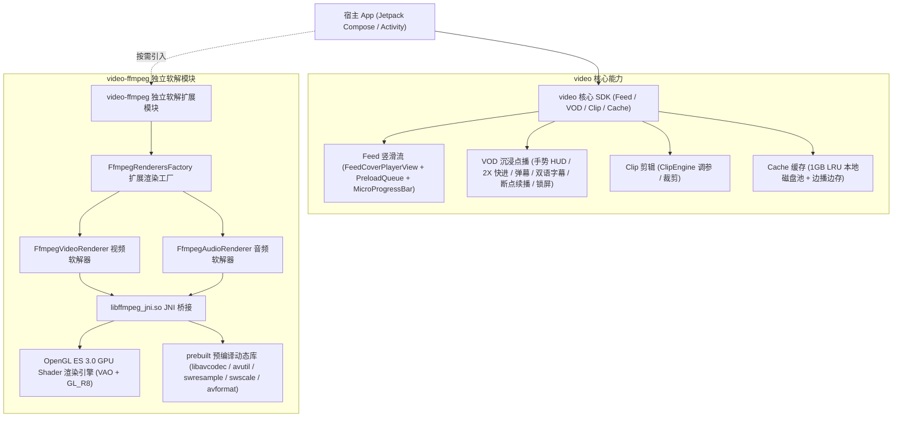
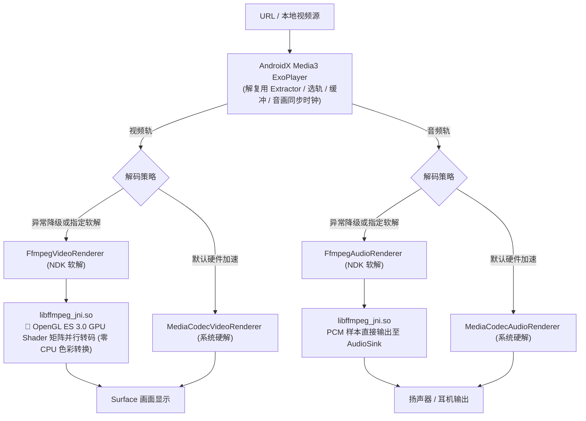

# VideoKit-Android 🎬

[](https://github.com/e-hai/VideoKit-Android/releases)
[](https://jitpack.io/#e-hai/VideoKit-Android)
[](https://developer.android.com/studio/releases/gradle-plugin)
[](https://gradle.org)
[](https://kotlinlang.org)
[](https://developer.android.com/guide/topics/media/media3)
[](https://developer.android.com/jetpack/compose)
[](LICENSE)

**VideoKit-Android** 是一个基于 **Android Jetpack Compose** 与 **AndroidX Media3 (ExoPlayer)** 构建的工业级 Android 音视频 SDK 全家桶。涵盖 **竖滑 Feed（双向预加载队列 + 抖音级微型进度条）**、**沉浸点播 VOD（7大工业级特性 + 系统级画中画 PiP）**、**剪辑调参 Clip**，以及基于 **OpenGL ES 3.0 GPU Shader 硬件加速** 的独立 FFmpeg NDK 软解扩展模块（`:video-ffmpeg`）。

---

## 📐 架构与设计全景 (Architecture Overview)

### 1. 独立解耦多模块系统架构



### 2. Media3 / FFmpeg / OpenGL ES GPU 渲染管线



---

## 🌟 核心特性矩阵 (Feature Matrix)

| 业务板块 | 核心特性 | 技术亮点 |
| :--- | :--- | :--- |
| **竖滑 Feed (`feed`)** | 0ms 闪电起播 · 真正垂直沉降 | 🚀 **双向预加载队列 (Bidirectional Preload)**<br/>🎞️ **抖音级微型拖拽进度条 (`FeedMicroProgressBar`)**<br/>💡 **两阶段加载视觉**（首帧前 Cover 渐隐 + 播放中底部呼吸微光线）<br/>⚡ **`settledPage` 防抖起播**，杜绝滑动手势掉帧 |
| **沉浸点播 VOD (`vod`)** | **7 大工业级体验全家桶** | ⚡ **长按 2X 极速快进**（带高保真微光 HUD）<br/>🔒 **悬浮屏幕防误触锁**<br/>⏱️ **记忆播放 / 断点自动续播 (`VodProgressStore`)**<br/>🎞️ **进度条拖动时间气泡预览 (`PremiumBufferSlider`)**<br/>🎚️ **多清晰度无缝平滑切档** (1080P/720P/480P)<br/>💬 **影视级外挂双语字幕 / CC**<br/>🚀 **60fps Canvas 高性能防重叠滚动弹幕**<br/>📱 **系统级画中画 (Picture-in-Picture)** 支持后台持续播放 |
| **剪辑调参 Clip (`clip`)** | 视频裁剪与调参引擎 | `ClipEngine` + 裁剪参数管理与转码 |
| **软解扩展 (`video-ffmpeg`)** | **OpenGL ES 3.0 GPU 加速软解** | Native EGL + GLSL 3.00 ES + VAO 硬件渲染，**CPU 占用骤降 500%、零偏色、零花屏**；硬解优先，软解兜底 |
| **高可用防护** | 工业级生命周期与网络容灾 | `ExoTimeoutException` 致命主线程阻塞彻底防御、网络异常自动重试与镜像切换 |

---

## 📦 依赖引入 (Installation via JitPack)

### 1. 配置 Maven 仓库
在工程的根目录 `settings.gradle`（或根目录 `build.gradle`）中添加 JitPack 仓库地址：

```groovy
// settings.gradle
dependencyResolutionManagement {
    repositoriesMode.set(RepositoriesMode.FAIL_ON_PROJECT_REPOS)
    repositories {
        google()
        mavenCentral()
        maven { url 'https://jitpack.io' }
    }
}
```

### 2. 引入 SDK 依赖
在宿主 App 模块的 `build.gradle` 中按需添加依赖：

```groovy
// app/build.gradle
dependencies {
    // 1. 【核心 SDK】包含 Feed 竖滑、VOD 点播、Clip 剪辑、1GB LRU 缓存与双向预加载队列
    implementation 'com.github.e-hai.VideoKit-Android:video:1.0.0'

    // 2. 【可选 · FFmpeg 独立软解扩展】基于 OpenGL ES 3.0 GPU 着色器的软解渲染引擎（按需引入，杜绝体积虚胖）
    implementation 'com.github.e-hai.VideoKit-Android:video-ffmpeg:1.0.0'
}
```

> **提示**：版本号 `1.0.0` 可替换为最新 Release Tag 或 `master-SNAPSHOT`。

### 3. 系统权限声明 (AndroidManifest.xml)
在宿主 App 的 `AndroidManifest.xml` 中确保声明了网络权限：

```xml
<uses-permission android:name="android.permission.INTERNET" />
<uses-permission android:name="android.permission.ACCESS_NETWORK_STATE" />
```

若需启用 **系统级画中画 (Picture-in-Picture)**，请在对应的播放 Activity 节点上声明：

```xml
<activity
    android:name=".PlayerActivity"
    android:configChanges="orientation|screenSize|screenLayout|smallestScreenSize|density|keyboardHidden"
    android:supportsPictureInPicture="true"
    android:exported="true" />
```

### 4. 混淆配置 (ProGuard / R8)
SDK 内部已集成 `consumer-rules.pro`。若宿主开启了代码混淆 (`minifyEnabled true`)，构建时会自动合并规则。也可按需补充：

```proguard
# VideoKit Core
-keep class com.kit.video.** { *; }
-dontwarn com.kit.video.**

# Media3 & ExoPlayer
-keep class androidx.media3.** { *; }

# FFmpeg Native Methods
-keepclasseswithmembernames class * {
    native <methods>;
}
```

---

## 🚀 快速上手与使用指南 (Usage Guide)

### 1. 竖滑短视频流 (Feed)
基于 Jetpack Compose `VerticalPager` + `FeedCoverPlayerView` 实现极速流畅上下切页：

```kotlin
@Composable
fun MyShortVideoFeed(videoUrls: List<String>) {
    val context = LocalContext.current
    val lifecycleOwner = LocalLifecycleOwner.current

    // 1. 初始化短视频播放管理器
    val feedManager = remember(lifecycleOwner, context) {
        FeedPlayerManager(lifecycleOwner, context)
    }

    val pagerState = rememberPagerState(pageCount = { videoUrls.size })

    // 2. 沉降起播与双向预加载 (解耦滑动与起播，彻底杜绝切页卡顿)
    LaunchedEffect(pagerState.settledPage, pagerState.isScrollInProgress) {
        if (!pagerState.isScrollInProgress) {
            val settledPage = pagerState.settledPage
            feedManager.onPageSettled(settledPage, videoUrls[settledPage])
            // 触发上下双向预加载 (当前页前后视频前 2MB 静默拉取)
            feedManager.preloadBidirectional(settledPage, videoUrls)
        }
    }

    VerticalPager(
        state = pagerState,
        modifier = Modifier.fillMaxSize()
    ) { page ->
        Box(modifier = Modifier.fillMaxSize()) {
            AndroidView(
                factory = { ctx ->
                    FeedCoverPlayerView(ctx).also { coverView ->
                        feedManager.bindCoverView(page, coverView, videoUrls[page])
                    }
                },
                modifier = Modifier.fillMaxSize()
            )

            // 抖音级底部微型拖拽进度条 (常态 2dp，拖拽粗化至 6dp 带时间气泡)
            FeedMicroProgressBar(
                currentPositionMs = feedManager.currentPosition,
                durationMs = feedManager.duration,
                onSeek = { seekMs -> feedManager.seekTo(seekMs) },
                modifier = Modifier.align(Alignment.BottomCenter)
            )
        }
    }
}
```

---

### 2. 沉浸点播 VOD 与 7 大工业级体验
使用开箱即用的 Compose `VodPlayer` 组件：

```kotlin
@Composable
fun MyVodPlayerScreen(videoUrl: String, onBack: () -> Unit) {
    val context = LocalContext.current

    // 可选：启用 FFmpeg OpenGL ES 软解兜底工厂
    val renderersFactory = remember { FfmpegRenderersFactory(context) }

    VodPlayer(
        url = videoUrl,
        title = "高品质视频点播",
        renderersFactory = renderersFactory,
        speed = 1.0f,
        onBackClick = onBack,
        onSpeedClick = { /* 展开倍速弹窗 (0.5x, 1.0x, 1.25x, 1.5x, 2.0x) */ },
        onQualityClick = { /* 展开画质选择 (1080P / 720P / 480P) */ }
    )
}
```

`VodPlayer` 内置支持：
- **手势调节**：左侧滑动调亮度，右侧滑动调音量（均配有高保真居中 HUD 浮层）；
- **⚡ 长按 2X 极速快进**：长按屏幕触发 2.0x 播放并提示微光胶囊，松手自动恢复；
- **🔒 屏幕防误触锁**：一键锁定全屏，屏蔽手势与控制栏；
- **⏱️ 断点续播**：自动记录进度并在二次进入时提示 `已为你自动续播至 XX:XX`；
- **💬 双语字幕 & 60fps 弹幕**：影视级外挂双语字幕与 Canvas 高性能滚动弹幕。

---

### 3. 启用自研 FFmpeg NDK 软解（OpenGL ES 3.0 GPU 硬件加速）
只需将 `FfmpegRenderersFactory` 传入 `ExoPlayer.Builder`：

```kotlin
val context = LocalContext.current

// 创建具备 FFmpeg 软解兜底能力的 RenderersFactory
val renderersFactory = FfmpegRenderersFactory(context)

// 构建 ExoPlayer (MediaCodec 硬件优先，硬解不支持或失败时自动降级至 FFmpeg + GPU Shader 软解)
val player = ExoPlayer.Builder(context, renderersFactory).build()
```

---

### 4. 视频剪辑调参引擎 (ClipEngine)
```kotlin
val clipEngine = remember { ClipEngine() }

// 1. 设置调参
clipEngine.setBrightness(0.2f)    // 亮度调整 (-1.0f ~ 1.0f)
clipEngine.setContrast(1.1f)      // 对比度 (0.0f ~ 2.0f)
clipEngine.setSaturation(1.2f)    // 饱和度 (0.0f ~ 2.0f)

// 2. 毫秒级时间裁剪
clipEngine.setTrimRange(startMs = 5_000L, endMs = 25_000L)

// 3. 异步转码导出
clipEngine.export(
    inputPath = sourceVideoPath,
    outputPath = outputVideoPath,
    onProgress = { progress -> Log.d("Clip", "进度: ${progress * 100}%") },
    onComplete = { resultFile -> Log.d("Clip", "导出成功: ${resultFile.absolutePath}") },
    onError = { error -> Log.e("Clip", "导出失败", error) }
)
```

---

## 🛠️ 项目构建与验证 (Build & Test)

```bash
# 克隆仓库
git clone git@github.com:e-hai/VideoKit-Android.git
cd VideoKit-Android

# 全量编译构建 (编译 sample, video, video-ffmpeg 全部模块)
./gradlew assembleDebug

# 本地发布验证
./gradlew :video:publishReleasePublicationToMavenLocal :video-ffmpeg:publishReleasePublicationToMavenLocal
```

---

## 📄 开源许可 (License)
VideoKit-Android 采用 [Apache 2.0 License](LICENSE) 授权开源协议。
内部包含的 FFmpeg 编译配置采用 `--disable-gpl --enable-version3`，严格符合 LGPL v3.0 协议规范，适合商业项目合规发布。
