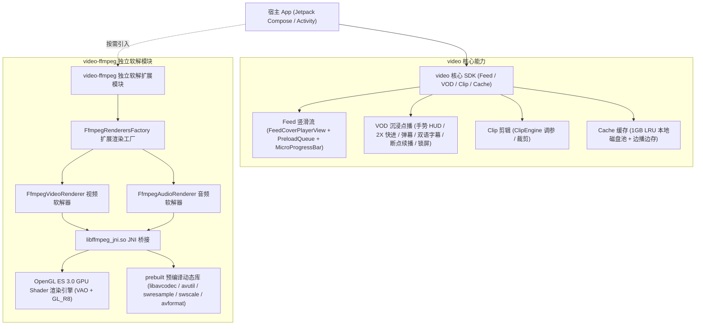
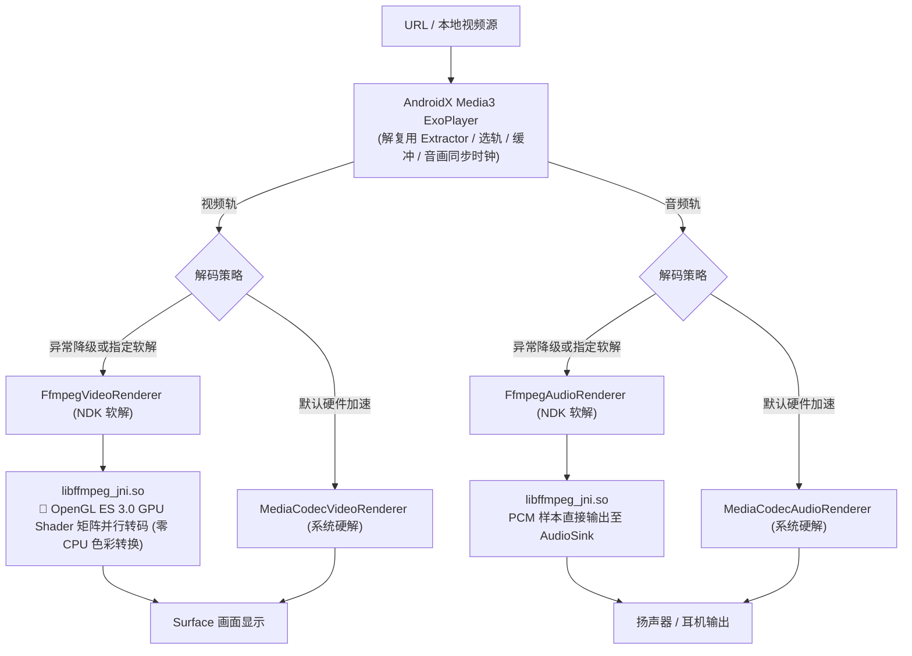

# VideoKit-Android 🎬

[](https://github.com/e-hai/VideoKit-Android/releases)
[](https://github.com/e-hai/VideoKit-Android/packages)
[](https://github.com/e-hai/VideoKit-Android/actions/workflows/ci.yml)
[](https://developer.android.com/studio/releases/gradle-plugin)
[](https://gradle.org)
[](https://kotlinlang.org)
[](https://developer.android.com/guide/topics/media/media3)
[](https://developer.android.com/jetpack/compose)
[](LICENSE)

**VideoKit-Android** 是一个基于 **Android Jetpack Compose** 与 **AndroidX Media3 (ExoPlayer)** 构建的工业级 Android 音视频 SDK 全家桶。涵盖 **竖滑 Feed（双向预加载队列 + 抖音级微型进度条）**、**沉浸点播 VOD（7大工业级特性 + 系统级画中画 PiP）**、**剪辑调参 Clip**，以及基于 **OpenGL ES 3.0 GPU Shader 硬件加速** 的独立 FFmpeg NDK 软解扩展模块（`:video-ffmpeg`）。

> 🍏 **iOS 版本**：请访问 [VideoKit-iOS](https://github.com/e-hai/VideoKit-iOS)。

---

## 📐 架构与设计全景 (Architecture Overview)

### 1. 独立解耦多模块系统架构



### 2. Media3 / FFmpeg / OpenGL ES GPU 渲染管线



---

## 🌟 核心特性矩阵 (Feature Matrix)

| 业务板块 | 核心特性 | 技术亮点 |
| :--- | :--- | :--- |
| **竖滑 Feed (`feed`)** | 0ms 闪电起播 · 真正垂直沉降 | 🚀 **双向预加载队列 (Bidirectional Preload)**<br/>🎞️ **抖音级微型拖拽进度条 (`FeedMicroProgressBar`)**<br/>💡 **两阶段加载视觉**（首帧前 Cover 渐隐 + 播放中底部呼吸微光线）<br/>⚡ **`settledPage` 防抖起播**，杜绝滑动手势掉帧 |
| **沉浸点播 VOD (`vod`)** | **7 大工业级体验全家桶** | ⚡ **长按 2X 极速快进**（带高保真微光 HUD）<br/>🔒 **悬浮屏幕防误触锁**<br/>⏱️ **记忆播放 / 断点自动续播 (`VodProgressStore`)**<br/>🎞️ **进度条拖动时间气泡预览 (`PremiumBufferSlider`)**<br/>🎚️ **多清晰度无缝平滑切档** (1080P/720P/480P)<br/>💬 **影视级外挂双语字幕 / CC**<br/>🚀 **60fps Canvas 高性能防重叠滚动弹幕**<br/>📱 **系统级画中画 (Picture-in-Picture)** 支持后台持续播放 |
| **剪辑调参 Clip (`clip`)** | 视频裁剪与调参引擎 | `ClipEngine` + `ClipParams` 裁剪区间、滤镜与图像参数调节 |
| **软解扩展 (`video-ffmpeg`)** | **OpenGL ES 3.0 GPU 加速软解** | Native EGL + GLSL 3.00 ES + VAO 硬件渲染，**CPU 占用骤降 500%、零偏色、零花屏**；硬解优先，软解兜底 |
| **高可用防护** | 工业级生命周期与网络容灾 | `ExoTimeoutException` 致命主线程阻塞彻底防御、网络异常自动重试与镜像切换 |

---

## 📦 依赖引入 (Installation via GitHub Packages)

> ⚠️ **GitHub Packages 鉴权说明**：  
> 与 JitPack 不同，**GitHub Packages（即使是 Public 公开仓库）要求开发者提供 GitHub 账号与只读 Token (`read:packages`) 才能通过 Gradle 拉取 Maven 制品**。请务必按以下步骤配置本机 `~/.gradle/gradle.properties` 或 CI 环境变量（切勿将 Token 硬编码提交到 Git 仓库）。

### 1. 生成 GitHub 只读 Token (PAT)
1. 登录 GitHub → 点击右上角头像 → **Settings** → **Developer settings** → **Personal access tokens** → **Tokens (classic)**；
2. 点击 **Generate new token (classic)**；
3. 仅勾选 **`read:packages`** 权限即可，生成并复制 Token。

### 2. 配置本地 Gradle 凭证（推荐全局配置）
在开发者本机用户目录下的 `~/.gradle/gradle.properties` 中添加（或在 CI 中注入环境变量 `GITHUB_ACTOR` 与 `GITHUB_TOKEN`）：

```properties
# ~/.gradle/gradle.properties
gpr.user=YOUR_GITHUB_USERNAME
gpr.key=ghp_YOUR_READ_PACKAGES_TOKEN
```

### 3. 配置 GitHub Packages Maven 仓库
在项目的 `settings.gradle.kts` 或 `settings.gradle` 中添加仓库：

#### Kotlin DSL (`settings.gradle.kts`)：
```kotlin
dependencyResolutionManagement {
    repositoriesMode.set(RepositoriesMode.FAIL_ON_PROJECT_REPOS)
    repositories {
        google()
        mavenCentral()
        maven {
            name = "GitHubPackages"
            // 注意：GitHub Packages 要求仓库 Owner 必须全小写 (e-hai)
            url = uri("https://maven.pkg.github.com/e-hai/VideoKit-Android")
            credentials {
                username = providers.gradleProperty("gpr.user").orNull ?: System.getenv("GITHUB_ACTOR")
                password = providers.gradleProperty("gpr.key").orNull ?: System.getenv("GITHUB_TOKEN")
            }
        }
    }
}
```

#### Groovy DSL (`settings.gradle`)：
```groovy
dependencyResolutionManagement {
    repositoriesMode.set(RepositoriesMode.FAIL_ON_PROJECT_REPOS)
    repositories {
        google()
        mavenCentral()
        maven {
            name = "GitHubPackages"
            url = uri("https://maven.pkg.github.com/e-hai/VideoKit-Android")
            credentials {
                username = providers.gradleProperty("gpr.user").orNull ?: System.getenv("GITHUB_ACTOR")
                password = providers.gradleProperty("gpr.key").orNull ?: System.getenv("GITHUB_TOKEN")
            }
        }
    }
}
```

### 4. 引入 SDK 依赖
在宿主 App 模块（如 `app/build.gradle.kts` 或 `app/build.gradle`）中添加依赖：

#### Kotlin DSL (`app/build.gradle.kts`)：
```kotlin
dependencies {
    // 1. 【核心 SDK】包含 Feed 竖滑、VOD 点播、Clip 剪辑、1GB LRU 缓存与双向预加载队列
    implementation("com.github.e-hai:video:1.0.1")

    // 2. 【可选 · FFmpeg 独立软解扩展】基于 OpenGL ES 3.0 GPU 着色器的软解渲染引擎（按需引入，杜绝体积虚胖）
    implementation("com.github.e-hai:video-ffmpeg:1.0.1")
}
```

#### Groovy DSL (`app/build.gradle`)：
```groovy
dependencies {
    // 1. 【核心 SDK】
    implementation 'com.github.e-hai:video:1.0.1'

    // 2. 【可选 · FFmpeg 独立软解扩展】
    implementation 'com.github.e-hai:video-ffmpeg:1.0.1'
}
```

> **从 JitPack 迁移指南 (Migration from JitPack)**：
> | 变更项 | 原 JitPack 配置 | 新 GitHub Packages 配置 |
> | :--- | :--- | :--- |
> | **仓库源** | `https://jitpack.io` | `https://maven.pkg.github.com/e-hai/VideoKit-Android` + `read:packages` 凭证 |
> | **核心库坐标** | `com.github.e-hai.VideoKit-Android:video:1.0.0` | `com.github.e-hai:video:1.0.1` |
> | **软解库坐标** | `com.github.e-hai.VideoKit-Android:video-ffmpeg:1.0.0` | `com.github.e-hai:video-ffmpeg:1.0.1` |

> **环境要求**：`minSdk = 24`（Android 7.0+），Java 17+，推荐 Gradle Kotlin/Groovy BOM 兼容性与 `compileSdk = 35+`。

### 5. 系统权限声明 (AndroidManifest.xml)
库内部已默认声明网络权限。若需启用 **系统级画中画 (Picture-in-Picture)**，请在宿主 App 的播放 `Activity` 节点添加以下配置：

```xml
<uses-permission android:name="android.permission.INTERNET" />
<uses-permission android:name="android.permission.ACCESS_NETWORK_STATE" />

<application ...>
    <activity
        android:name=".PlayerActivity"
        android:configChanges="orientation|screenSize|screenLayout|smallestScreenSize|density|keyboardHidden"
        android:supportsPictureInPicture="true"
        android:exported="true" />
</application>
```

### 6. 混淆配置 (ProGuard / R8)
SDK 内部已集成 `consumer-rules.pro`。若宿主开启了代码混淆 (`minifyEnabled = true`)，构建时会自动合并规则，也可按需补充：

```proguard
# VideoKit Core
-keep class com.kit.video.** { *; }
-dontwarn com.kit.video.**

# Media3 & ExoPlayer
-keep class androidx.media3.** { *; }

# FFmpeg Native Methods
-keepclasseswithmembernames class * {
    native <methods>;
}
```

---

## 🚀 快速上手与使用指南 (Usage Guide)

### 1. 竖滑短视频流 (Feed)
基于 Jetpack Compose `VerticalPager` + `FeedCoverPlayerView` + `FeedPlayerManager` 实现极速流畅上下切页：

```kotlin
import androidx.compose.foundation.layout.Box
import androidx.compose.foundation.layout.fillMaxSize
import androidx.compose.foundation.layout.fillMaxWidth
import androidx.compose.foundation.pager.VerticalPager
import androidx.compose.foundation.pager.rememberPagerState
import androidx.compose.runtime.*
import androidx.compose.ui.Alignment
import androidx.compose.ui.Modifier
import androidx.compose.ui.platform.LocalContext
import androidx.compose.ui.viewinterop.AndroidView
import androidx.lifecycle.compose.LocalLifecycleOwner
import com.kit.video.feed.FeedCoverPlayerView
import com.kit.video.feed.FeedMicroProgressBar
import com.kit.video.feed.FeedPlayerManager
import kotlinx.coroutines.delay

@Composable
fun MyShortVideoFeed(videoUrls: List<String>) {
    val context = LocalContext.current
    val lifecycleOwner = LocalLifecycleOwner.current

    // 1. 初始化短视频播放管理器（已内置 ExoTimeoutException 生命周期防护）
    val feedManager = remember(lifecycleOwner, context) {
        FeedPlayerManager(lifecycleOwner, context)
    }

    val pagerState = rememberPagerState(pageCount = { videoUrls.size })
    val coverViews = remember { mutableStateMapOf<Int, FeedCoverPlayerView>() }
    var lastPlayedPage by remember { mutableIntStateOf(-1) }

    // 2. 沉降起播与双向预加载 (解耦滑动手势与起播，彻底杜绝切页卡顿)
    LaunchedEffect(pagerState.settledPage, pagerState.isScrollInProgress) {
        if (!pagerState.isScrollInProgress) {
            val settledPage = pagerState.settledPage
            if (settledPage != lastPlayedPage) {
                val coverView = coverViews[settledPage]
                val currentUrl = videoUrls.getOrNull(settledPage)
                if (coverView != null && currentUrl != null) {
                    lastPlayedPage = settledPage
                    feedManager.playVideoFromCoverView(coverView, currentUrl)

                    // 触发上下双向预加载队列 (前后视频前 2MB 数据静默拉取至 1GB LRU 缓存)
                    feedManager.preloadBidirectional(
                        prevVideoUrl = videoUrls.getOrNull(settledPage - 1),
                        nextVideoUrl = videoUrls.getOrNull(settledPage + 1)
                    )
                }
            }
        }
    }

    // 3. 定时同步播放进度用于微型拖拽进度条
    var currentPositionMs by remember { mutableLongStateOf(0L) }
    var bufferedPositionMs by remember { mutableLongStateOf(0L) }
    var durationMs by remember { mutableLongStateOf(0L) }
    LaunchedEffect(feedManager) {
        while (true) {
            currentPositionMs = feedManager.getCurrentPosition()
            bufferedPositionMs = feedManager.getBufferedPosition()
            durationMs = feedManager.getDuration()
            delay(100)
        }
    }

    Box(modifier = Modifier.fillMaxSize()) {
        VerticalPager(
            state = pagerState,
            modifier = Modifier.fillMaxSize()
        ) { page ->
            AndroidView(
                factory = { ctx ->
                    FeedCoverPlayerView(ctx).also { view -> coverViews[page] = view }
                },
                update = { view -> coverViews[page] = view },
                modifier = Modifier.fillMaxSize()
            )
        }

        // 抖音级底部微型拖拽进度条 (常态 2dp，拖拽粗化至 6dp 带时间气泡)
        FeedMicroProgressBar(
            currentPositionMs = currentPositionMs,
            bufferedPositionMs = bufferedPositionMs,
            durationMs = durationMs,
            onSeekTo = { targetMs ->
                feedManager.seekTo(targetMs)
                currentPositionMs = targetMs
            },
            modifier = Modifier
                .align(Alignment.BottomCenter)
                .fillMaxWidth()
        )
    }
}
```

---

### 2. 沉浸点播 VOD 与 7 大工业级体验
使用开箱即用的 Compose `VodPlayer` 组件：

```kotlin
import androidx.compose.runtime.Composable
import androidx.compose.runtime.remember
import androidx.compose.ui.platform.LocalContext
import com.kit.video.ffmpeg.FfmpegRenderersFactory
import com.kit.video.vod.VodPlayer

@Composable
fun MyVodPlayerScreen(videoUrl: String, onBack: () -> Unit) {
    val context = LocalContext.current

    // 可选：启用 FFmpeg OpenGL ES 3.0 软解兜底工厂
    val renderersFactory = remember { FfmpegRenderersFactory(context) }

    VodPlayer(
        url = videoUrl,
        title = "高品质视频点播",
        renderersFactory = renderersFactory,
        speed = 1.0f,
        onBackClick = onBack,
        onSpeedClick = { /* 展开倍速面板 (0.5x, 1.0x, 1.25x, 1.5x, 2.0x) */ },
        onQualityClick = { /* 展开清晰度选择 (1080P / 720P / 480P) */ }
    )
}
```

`VodPlayer` 内置支持：
- **手势调节**：左侧滑动调亮度，右侧滑动调音量（均配有高保真居中 HUD 浮层）；
- **⚡ 长按 2X 极速快进**：长按屏幕触发 2.0x 播放并提示微光胶囊，松手自动恢复；
- **🔒 屏幕防误触锁**：一键锁定全屏，屏蔽手势与控制栏；
- **⏱️ 断点续播**：自动记录进度并在二次进入时提示 `已为你自动续播至 XX:XX`；
- **💬 双语字幕 & 60fps 弹幕**：影视级外挂双语字幕与 Canvas 高性能滚动弹幕。

---

### 3. 启用自研 FFmpeg NDK 软解（OpenGL ES 3.0 GPU 硬件加速）
只需将 `FfmpegRenderersFactory` 传入 `ExoPlayer.Builder`：

```kotlin
import androidx.media3.exoplayer.ExoPlayer
import com.kit.video.ffmpeg.FfmpegRenderersFactory

val context = LocalContext.current

// 创建具备 FFmpeg 软解兜底能力的 RenderersFactory
val renderersFactory = FfmpegRenderersFactory(context)

// 构建 ExoPlayer (MediaCodec 硬件优先，硬解不支持或失败时自动降级至 FFmpeg + GPU Shader 软解)
val player = ExoPlayer.Builder(context, renderersFactory).build()
```

---

### 4. 视频剪辑调参引擎 (ClipEngine)
```kotlin
import com.kit.video.clip.ClipEngine
import com.kit.video.clip.ClipParams

val clipEngine = remember(context) { ClipEngine(context) }

// 1. 全量更新剪辑与调参模型
clipEngine.updateParams(
    ClipParams(
        trimStartMs = 5_000L,
        trimEndMs = 25_000L,
        filterName = "Vivid",
        brightness = 0.6f,  // 亮度
        contrast = 0.7f,    // 对比度
        saturation = 0.8f   // 饱和度
    )
)

// 2. 单独更新滤镜或色彩调节
clipEngine.applyFilter("Cyberpunk")
clipEngine.updateAdjustment(brightness = 0.5f, contrast = 0.6f, saturation = 0.7f)

// 3. 计算有效裁剪时长
val durationMs = clipEngine.getTrimDurationMs()
```

---

## 🛠️ 本地构建与 GitHub Packages 发布指南 (Build & Publish)

```bash
# 克隆仓库
git clone git@github.com:e-hai/VideoKit-Android.git
cd VideoKit-Android

# 全量编译构建 (编译 sample, video, video-ffmpeg 全部模块)
./gradlew assembleDebug

# 发布到本机 Maven Local (~/.m2/repository) 进行联调验证
./gradlew :video:publishReleasePublicationToMavenLocal :video-ffmpeg:publishReleasePublicationToMavenLocal

# 手动发布到 GitHub Packages (需已配置 ~/.gradle/gradle.properties 或环境变量 GITHUB_TOKEN)
./gradlew :video:publishReleasePublicationToGitHubPackagesRepository \
  :video-ffmpeg:publishReleasePublicationToGitHubPackagesRepository
```

### CI/CD 自动发包（维护者）
本项目内置 GitHub Actions 自动化发布工作流 [`.github/workflows/publish-packages.yml`](.github/workflows/publish-packages.yml)：
- **Tag 触发**：推送符合版本号格式的 Git Tag（例如 `git tag 1.0.1 && git push origin 1.0.1`），CI 将自动使用 `GITHUB_TOKEN` 将 `:video` 与 `:video-ffmpeg` 发布至 GitHub Packages；
- **手动触发**：在 GitHub 仓库 `Actions` → `Publish to GitHub Packages` → `Run workflow` 中可随时指定版本号手动触发。

> ⚠️ **注意**：GitHub Packages 不允许覆盖已发布的相同正式版本号；再次发包请先递增 `gradle.properties` 中的 `VERSION_NAME` 与新 Git Tag。

---

## 📄 开源许可 (License)
VideoKit-Android 采用 [Apache 2.0 License](LICENSE) 授权开源协议。
内部包含的 FFmpeg 编译配置采用 `--disable-gpl --enable-version3`，严格符合 LGPL v3.0 协议规范，适合商业项目合规发布。
